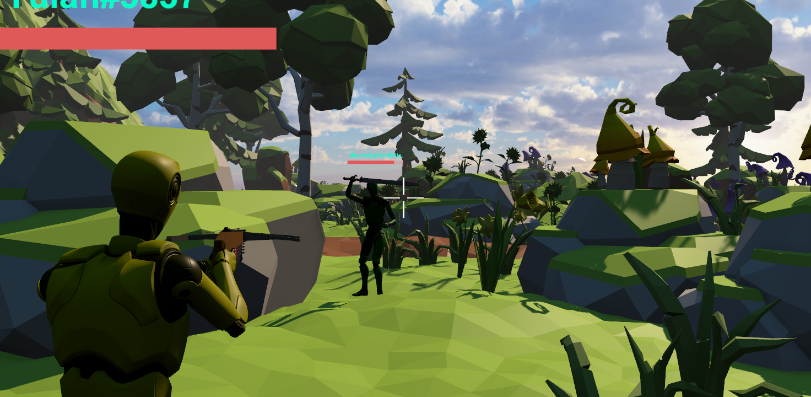

# AgaRPG — Networked Third-Person Combat Demo

An _Agar_ multiplayer third-person action/RPG prototype built with **Unity 6** and **[Fish-Networking](https://fish-networking.gitbook.io/docs)**.
Players sign in, are matched into an online session through Unity Gaming Services, and fight with
crossbows and a directional-melee sword. Every kill makes you bigger, stronger and slower to kill;
every death shrinks you back down. Implementing the RPG element is left as an exercise to the user.



## Download and play (Windows)

Grab the latest **`AgaRPG-Windows-v*.zip`** from the
[Releases page](https://github.com/yulanvanoppen/AgaRPG/releases/latest), extract it and run `AgaRPG.exe`.
Press **Play**: you join an open game or host a new one, and others join you over the internet
(no port forwarding). To try multiplayer on your own, start the game twice. Each copy signs in as
a different player.

> Windows may warn that the app is unrecognised because it isn't code-signed: choose
> **More info → Run anyway**.

## Highlights

- **Client-side prediction with server reconciliation** for movement and combat
  (`[Replicate]` / `[Reconcile]`), so the local player responds instantly while the server stays authoritative.
- **Directional melee combat** (strike from left, right, above or below by flicking the mouse; hold
  right mouse to block in a direction) driven by Animation Rigging IK constraints.
- **Latency-compensated strike animations** — the owner's swing is slowed at the start and catches up,
  so it lines up with the server's authoritative hit window instead of visibly cutting through opponents
  early (see [Strike latency compensation](#strike-latency-compensation)).
- **Swept melee hit detection**: the blade is swept between frames (interpolated poses, sphere casts
  along the whole blade), so hits register even during frame or tick hitches instead of the blade
  passing through targets between two samples.
- **Hitscan crossbows** with fire rate, clip and automatic reload, recoil patterns, camera kick and tracers.
- **Server-authoritative weapons and damage**: weapon pickups, equipping, hit registration, death,
  respawn and spawn protection all run on the server; clients only render the results.
- **Online services**: anonymous sign-in or Unity Player Accounts, player names, Cloud Save for each
  player's size and colour, quick-join Lobby and Unity Relay (no port forwarding needed).
- **Headless dedicated server** support (batch mode hosts automatically and mutes audio).

## Controls

| Action | Input |
| --- | --- |
| Move / sprint / jump | WASD / Shift / Space |
| Look / zoom | Mouse / scroll wheel |
| Aim (ranged) · Block (melee) | Right mouse |
| Shoot (ranged) | Left mouse |
| Melee strike | Hold left mouse, flick the mouse to choose a direction, release to strike |
| Pause menu / colour picker | Esc |

_Very basic weapon switching:_ Walk over a floating weapon to pick it up; the empty pad unequips you.

## Running the project

1. Open with **Unity 6000.6.5f1** (other Unity 6 versions likely work).
2. Link the project to a Unity Cloud project (**Edit → Project Settings → Services**) and enable
   **Authentication**, **Lobby**, **Relay** and **Cloud Save** in the Unity Cloud dashboard.
   For "Sign in with Unity", also configure **Player Accounts** and its Client ID.
3. Open `Assets/_Game/Scenes/Auth.unity` and press Play, then **Play** in the menu. The first player
   creates a lobby and hosts; everyone after quick-joins it.

### Development shortcuts

- **AgaRPG → Quick Start (skip login)** — Play Mode then always starts from the Auth scene, skips
  sign-in, lobby and relay, hosts on `localhost` and loads straight into the Game scene.
- **Multiple clients**: the project includes [ParrelSync](https://github.com/VeriorPies/ParrelSync).
  With quick start on, a clone joins the main editor's local game; with it off, each clone signs in
  with its own Unity Services profile and joins through the lobby.

### Making a release

- **Locally:** bump *Project Settings → Player → Version*, then **AgaRPG → Build Windows (zip)**.
  This builds `Builds/AgaRPG-Windows/AgaRPG.exe` and zips it to `Builds/AgaRPG-Windows-v<version>.zip`,
  ready to attach to a [GitHub release](https://github.com/yulanvanoppen/AgaRPG/releases/new).
- **Automatically:** push a tag such as `v0.5.0`. The `Release Windows build` workflow
  ([`.github/workflows/release-windows.yml`](.github/workflows/release-windows.yml)) builds the player
  with [GameCI](https://game.ci) and publishes the zip as a release. It needs the `UNITY_EMAIL`,
  `UNITY_PASSWORD` and `UNITY_LICENSE` repository secrets.
- Running two copies of a build on one PC works because each copy uses its own Unity Services
  profile (`Standalone`, `Standalone2`, ...). Use `AgaRPG.exe -profile <name>` to pick one explicitly.

## Architecture

```
Assets/_Game/
├── Scenes/            Auth (sign-in + lobby, entry point) · Game (arena)
├── Scripts/
│   ├── Player/        movement, camera, animation, input, state, attributes (health/size/colour)
│   ├── Combat/        PlayerCombat, weapons (melee/raycast), recoil, pickups, strike compensation
│   ├── Networking/    session flow (lobby + relay), UGS authentication, cloud save, player spawning
│   ├── UI/            pause menu, reticle, health bars and name tags, loading overlay
│   ├── Audio/         music playlist and cross-fading
│   ├── Dev/           development switches (quick start)
│   └── Editor/        Quick Start and Build Windows menus
├── Character/  Environment/  Lobby/   models, animations, prefabs, audio, materials
```

All game code lives in `AgaRPG.*` namespaces.

### Session flow

`AuthenticationManager` (Auth scene, persists across scenes) initialises Unity Services and signs in.
**Play** tries `QuickJoinLobby`; if a lobby exists the client joins its Relay allocation, otherwise it
creates a Relay allocation and a lobby that carries the join code, starts a FishNet host and loads the
Game scene for everyone with FishNet's scene manager. `GameManager` (a scene object in the Game scene)
spawns a player for each client when it receives that client's spawn request.

### Prediction and authority

| System | Owner (client) | Server |
| --- | --- | --- |
| Movement (`PlayerMovement`) | predicts from local input | simulates the same input, sends reconcile state |
| Combat (`PlayerCombat`) | predicts aim, stance and swings | simulates, owns hit detection and damage |
| Health, death, size, spawn protection (`PlayerAttributes`) | renders | `SyncVar`s written by the server only |
| Weapons (`PlayerWeapons`, `WeaponPickup`) | attaches the weapon from a buffered RPC | spawns/despawns weapons with ownership |
| Shot effects (`RaycastWeapon`) | plays immediately | relays one RPC per shot to other clients |

Visual-only work (animations, sounds, effects) is skipped during reconciliation replays, and purely
cosmetic objects such as tracers are never network-spawned.

### Strike latency compensation details

With prediction, the owner starts a swing immediately, but the server only simulates that input about
half a round trip (plus its input buffer) later. `StrikeTimingCompensator` slows the owner's swing with a
playback speed of `(t / T)²` that reaches full speed after `T` seconds. After those `T` seconds the
animation has advanced only `∫₀ᵀ (t/T)² dt = T/3`, so from then on it lags real time by `2T/3`. Choosing
`T = 1.5 × delay` makes the owner's blade line up with the server's, while the swing still starts the
instant the button is released. The delay
estimate is `RTT / 2 + bufferedTicks × tickDelta`, taken from FishNet's `TimeManager`.

## Tech stack

Unity 6 (URP) · Fish-Networking 4 · FishyUnityTransport (Unity Transport + Relay) · Unity Gaming
Services (Authentication, Player Accounts, Lobby, Relay, Cloud Save) · Cinemachine 3 · Animation
Rigging · Input System · DOTween · ParrelSync

## Credits

Third-party assets keep their own licences: Unity Starter Assets (third-person controller basis),
Fish-Networking, FishyUnityTransport, ParrelSync, DOTween, `DoubleAudioSource` by Igor Aherne, the
Free Low Poly Nature pack, the Pistol/Handgun locomotion animation pack, and the 25 RPG Game Tracks music pack.
